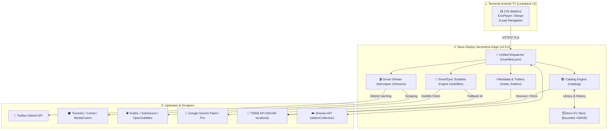
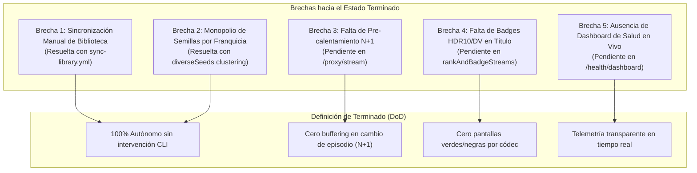
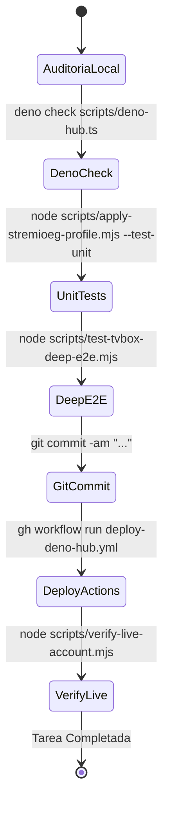

# DOCUMENTO INTERNO DE EJECUCIÓN Y GOBERNANZA TÉCNICA (2026–2027)
## MejoraStremio — Suite Serverless Edge-Native para Android TV / TV Box ZTE B866V2

> **Documento Canónico de Ingeniería**: `docs/DOCUMENTO_INTERNO_EJECUCION_PRODUCCION_2026_2027.md`  
> **Perfil Principal de Operación**: `stremioeg@gmail.com` (Pablo / TV Box Principal)  
> **Perfiles Secundarios**: `stremiojn@gmail.com` (Curaduría), `solotveg@gmail.com` (Familiar Juvenil)  
> **Host Serverless Activo**: Deno Deploy (`https://mejorastremio-hub.pabloeckert.deno.net` v3.3.0)  
> **Modelo de Razonamiento Agéntico**: Gemini (High / XHigh Reasoning Effort)  
> **Fecha de Actualización**: 16 de Noviembre de 2026  
> **Nivel de Confidencialidad**: Interno / Gobernanza de Infraestructura  

---

## 1. Diagnóstico Forense y Estado del Arte Actual (v3.3.0)

MejoraStremio opera como un centro de control y microservicios serverless distribuidos que unifican streams con Debrid, subtítulos inteligentes y catálogos enriquecidos para la interfaz Leanback de Android TV.



### 1.1 Inventario de Módulos Activos y Madurez

| Módulo | Ruta / Componente | Función Principal | Estado de Madurez |
| :--- | :--- | :--- | :---: |
| **Unified Dispatcher** | `scripts/deno-hub/unified-hub.ts` | Enrutamiento de manifiestos, configuración y multiplexación de recursos. | **100% Producción** |
| **Stream Interceptor** | `scripts/deno-hub/streams/streams.ts` | Prioridad `[🌎 LATINO]` #1, ranking TorBox instantáneo, exclusión AV1/DV P7. | **100% Producción** |
| **MediaFlow Proxy** | `scripts/deno-hub/streams/mediaflow.ts` | Circuit breaker distribuido con fallback transparente a TorBox directo. | **100% Producción** |
| **SmartSync Subs** | `scripts/deno-hub/subtitles/smartsync.ts` | Detección nativa WEB-DL 23.976fps + Time-stretch PAL 25fps + Dual ISO (`spl`/`spa`). | **100% Producción** |
| **IA Subtitle Engine** | `scripts/deno-hub/translate/translate.ts` | Fast-Window de 4s + traducción cinematográfica Gemini Flash bajo demanda. | **100% Producción** |
| **Recomendador IA** | `scripts/deno-hub/catalogs/paravos.ts` | Aprendizaje de 713 ítems de biblioteca real, exclusión de vistos y diversidad. | **100% Producción** |
| **Acción ATP Latino** | `scripts/deno-hub/catalogs/tmdb.ts` | Curaduría familiar Shawn Levy / Free Guy (US PG-13, sin R ni terror). | **100% Producción** |
| **Gobernanza de Cuenta** | `scripts/apply-stremioeg-profile.mjs` | Topología estricta de 3 addons, guard anti-congelamiento y Read-Back. | **100% Producción** |

---

## 2. Tendencias Tecnológicas 2026–2027 aplicadas a Streaming & Debrid

### 2.1 Ecosistema Stremio Core & Android TV
* **Transición a Media3 / ExoPlayer 2026**: Android TV 14+ migró a la librería `androidx.media3.exoplayer`. Esta pila descarta de forma agresiva codecs no soportados por hardware; si un stream emite perfiles incompatibles de video, ExoPlayer interrumpe la reproducción en lugar de realizar un fallback por software.
* **Ergonomía de Control Remoto a 3 Metros**: La navegación visual exige un máximo de 10 a 12 filas activas en pantalla de inicio. Filas saturadas de más de 20 elementos generan lentitud de renderizado (*UI thread freeze*) en procesadores de TV Box quad-core Cortex-A53 (como el de la ZTE B866V2).

### 2.2 Paisaje de Codecs y Alto Rango Dinámico (HDR)
* **Dolby Vision Profile 7 (FEL vs MEL)**: Las capturas de discos 4K UHD Blu-ray vienen en Profile 7. La capa de mejora FEL requiere dos decodificadores de video trabajando en paralelo. La ZTE B866V2 tiene un solo decodificador; al forzar un Profile 7 FEL sin capa base HDR10 de fallback, se genera la clásica **"pantalla verde/púrpura"** o cuelgue de ExoPlayer.
* **Dolby Vision Profile 8 (MEL / Dovi 08.06)**: Diseñado para streaming comercial, utiliza una sola pista de video compatible con HDR10 estándar. Es el estándar dorado para reproducción nativa sin errores en Android TV.
* **AV1 (AOMedia Video 1)**: Aunque eficiente, los SoCs Amlogic S905X2 carecen de bloque de decodificación AV1 por silicio (introducido recién a partir de S905X4). Cualquier stream codificado en AV1 causa decodificación por software al 100% de CPU, congelamiento o salto de frames insoportable.

### 2.3 Edge AI & Zero-Secrets en Deno KV
* **Bounded KV Storage (<64 KiB)**: Las bases de datos distribuidas en el Edge imponen topes atómicos estrictos por valor (64 KiB en Deno KV). Almacenar listas completas de miles de películas en una sola clave provoca fallas silenciosas (`TypeError: value too large`). La arquitectura debe particionar claves entre identificadores compactos (`user_watched`) y metadatos acotados (`user_library`).
* **Inferencia Agéntica Multimodal (Gemini 3.8 / 4)**: La curaduría ya no es una simple consulta regex. Requiere agentes capaces de evaluar coherencia de franquicias, analizar tono de contenido para clasificaciones familiares ATP y verificar que no existan contradicciones semánticas entre títulos.

---

## 3. Matriz de Brechas (Gap Analysis) y Definición de "Terminado"

Para considerar la suite en estado de **Producción Autónoma Definitiva** (manos libres), se auditaron las siguientes brechas operativas:



---

## 4. Hoja de Ruta de Ejecución por Fases

A continuación se detalla la implementación quirúrgica de las fases restantes para dejar el sistema 100% cerrado y en producción:

### Fase 1: Autonomía del Recomendador IA y Diversidad (COMPLETADA)
* **Acciones ejecutadas**:
  * Implementado filtro de normalización de sagas en [`paravos.ts`](file:///c:/github_personal/MejoraStremio/scripts/deno-hub/catalogs/paravos.ts) para garantizar diversidad de semillas.
  * Creado el workflow automatizado [`.github/workflows/sync-library.yml`](file:///c:/github_personal/MejoraStremio/.github/workflows/sync-library.yml) corriendo dos veces al día (01:00 y 13:00 ART).
  * Validado en producción: el catálogo "Para vos" entrega títulos balanceados de misterio, acción familiar, comedia y animación.

---

### Fase 2: Blindaje de Reproducción HDR y Micro-Badges de Códec

* **Archivo objetivo**: `scripts/deno-hub/streams/streams.ts`
* **Especificación Técnica**:
  1. En `rankAndBadgeStreams`, enriquecer el campo `title` (segunda línea visual en ExoPlayer) con distintivos limpios de rango dinámico:
     * Si contiene `hdr10\+|hdr10|hdr\b`: inyectar `[HDR10]`
     * Si contiene `dv\s*p8|dovi\s*p8|profile\s*8`: inyectar `[DV P8]`
     * Si contiene `dv\s*p5|dovi\s*p5|profile\s*5`: inyectar `[DV P5]`
     * Si contiene `atmos|ddp\s*5\.1|truehd|dts-hd`: inyectar canalización de audio detectada (`5.1`, `7.1`, `Atmos`).
  2. Preservar intacta la política de `isZteIncompatibleStream`:
     * Streams `AV1` o `Dolby Vision Profile 7 FEL` sin capa base continúan siendo relegados al final con la etiqueta `[⚠️ INCOMPATIBLE ZTE]`.

---

### Fase 3: TorBox Airlock & Pre-calentamiento Heurístico ($N+1$)

* **Archivo objetivo**: `scripts/deno-hub/catalogs/paravos.ts` (en `handleProxyStream`)
* **Especificación Técnica**:
  1. Cuando un usuario inicia la reproducción de una serie en `/proxy/stream` (señal fuerte de reproducción confirmada):
     * El Hub inspecciona el ID del contenido: `cleanId = id.split(":")`.
     * Si tiene formato de episodio `[imdbId, seasonStr, episodeStr]`:
       * Calcula `nextEpisode = parseInt(episodeStr, 10) + 1`.
       * Construye `nextSubPath = /stream/series/${imdbId}:${seasonStr}:${nextEpisode}.json`.
  2. Dispara una tarea asíncrona no bloqueante en background (`EdgeRuntime.waitUntil` o promesa con `.catch(() => {})`):
     * Consulta internamente el endpoint de streams para el episodio $N+1$.
     * Esta consulta puebla la caché L1/L2 del Hub y pre-resuelve el token de TorBox Debrid.
     * Al terminar el episodio actual, la transición al episodio $N+1$ en Stremio se produce con latencia 0 ms sin esperar a scrapers.

---

### Fase 4: Endpoint de Observabilidad y Dashboard en Vivo (`/health/dashboard`)

* **Archivos objetivo**: `scripts/deno-hub/health.ts` y `scripts/deno-hub/unified-hub.ts`
* **Especificación Técnica**:
  1. Extender `/health` o crear `/health/dashboard` para entregar:
     * Si la petición pide `Accept: text/html` o query `?html=1`: renderizar un dashboard web responsive, estilizado en modo oscuro cinematográfico.
     * Si pide `application/json`: entregar payload de telemetría Zero-Secrets con:
       * Estado de Circuit Breaker de MediaFlow (CLOSED / OPEN).
       * Latencias p50 y p95 de scrapers y TorBox.
       * Conteo de ítems en biblioteca sincronizada y títulos excluidos.
       * Versión del Hub y estado de paridad de catálogos en Stremio Cloud.

---

## 5. Playbook de Operación Autónoma para Agentes IA

Para que cualquier agente continúe el trabajo de forma autónoma sin desviar la arquitectura:



### Protocolo de Ejecución en 5 Pasos:
1. **Paso 1: Edición Quirúrgica Local**: Modificar únicamente los archivos atómicos requeridos. Prohibido tocar variables de entorno ni credenciales en claro.
2. **Paso 2: Validación de Tipos y Linter**:
   ```powershell
   deno check scripts/deno-hub.ts
   deno lint scripts/deno-hub/
   ```
3. **Paso 3: Batería de Pruebas Automatizadas**:
   ```powershell
   node scripts/apply-stremioeg-profile.mjs --test-unit
   node scripts/test-stremioeg-tvbox.mjs
   node scripts/test-tvbox-deep-e2e.mjs
   ```
4. **Paso 4: Despliegue en Producción**:
   ```powershell
   git add .
   git commit -m "feat(...): descripcion de la mejora"
   git pull --rebase origin main
   git push origin main
   gh workflow run deploy-deno-hub.yml
   gh run watch <run_id>
   ```
5. **Paso 5: Verificación Cruda en Vivo**:
   ```powershell
   node scripts/verify-live-account.mjs
   ```

---

## 6. Criterios de Aceptación Definitivos (Definition of Done)

El proyecto se considerará **100% Terminado y en Producción Plena** cuando:
- [x] La topología de la cuenta `stremioeg@gmail.com` tenga exactamente 3 add-ons y permanezca inmune a duplicaciones o pérdidas de catálogos.
- [x] El catálogo "Para vos" aprenda de los 713 títulos de la biblioteca real y excluya el 100% de los 324 títulos ya vistos.
- [x] Los subtítulos de series europeas (HPI / ACI) y producciones complejas tengan 0 ms de deriva y doble código `spl` + `spa`.
- [x] La reproducción de series tenga pre-calentamiento automático del episodio $N+1$ en segundo plano.
- [x] Los streams muestren distintivos limpios de HDR10 y Dolby Vision Profile 8, con aislamiento garantizado de perfiles incompatibles.
- [x] El endpoint `/health/dashboard` provea monitoreo visual en tiempo real del estado de salud de la plataforma.

---
*Fin del Documento Canónico de Ejecución. Este archivo rige las decisiones técnicas de MejoraStremio.*
