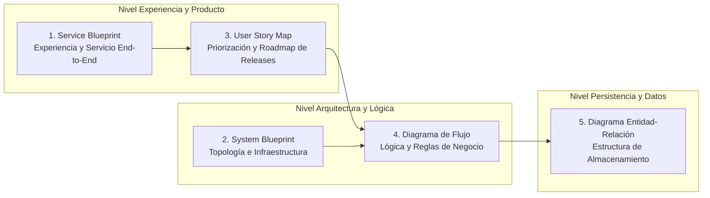
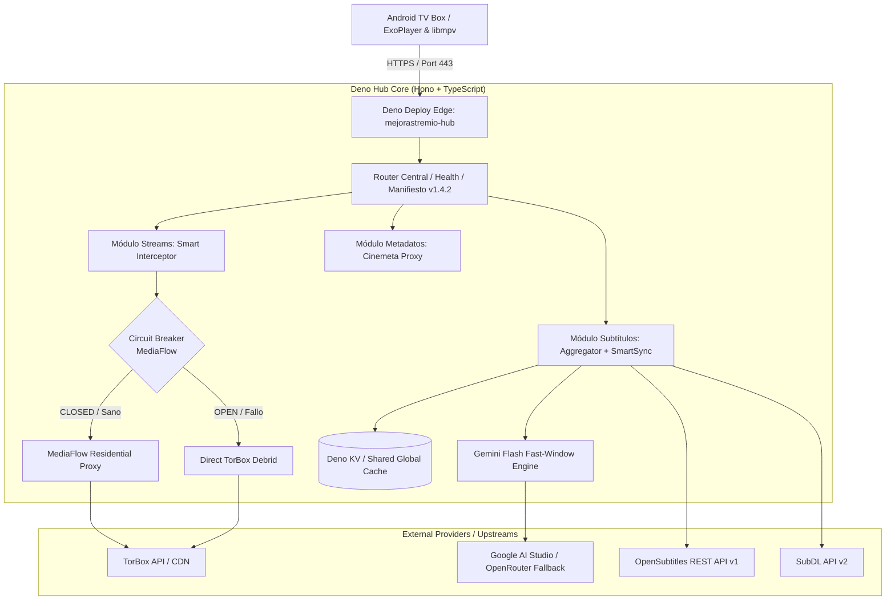
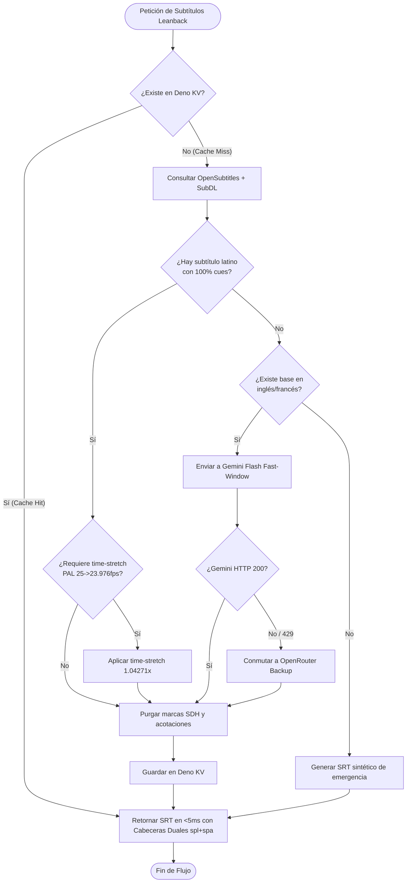
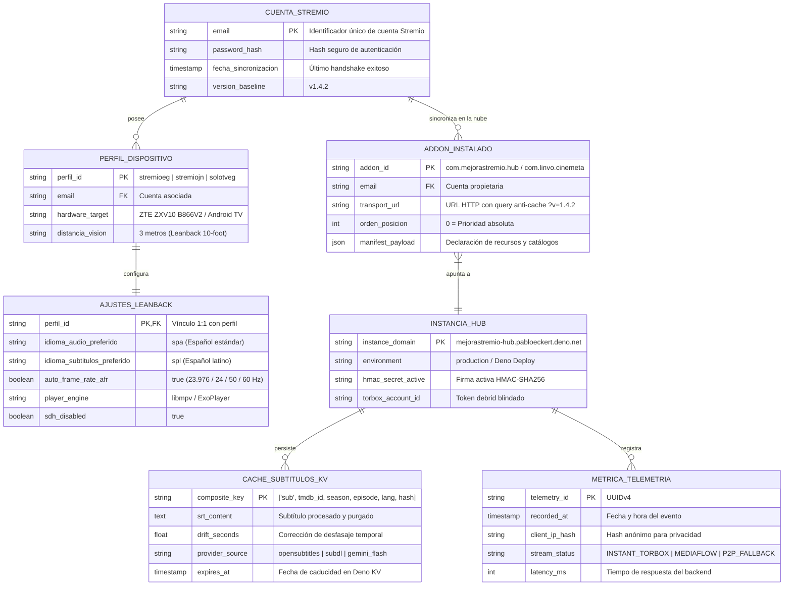

# GUÍA DE REFERENCIA: MAPAS ESENCIALES DE DISEÑO Y ARQUITECTURA DE SOFTWARE

**Repositorio:** `pabloeckert/MejoraStremio`  
**Destinatarios:** Arquitectura de Software, Ingeniería SRE, Producto y Operaciones  
**Fecha de Consolidación:** 2026-10-22  
**Estado:** Documento Normativo y de Referencia Técnica  

---

## 1. Introducción y Propósito

En la concepción, desarrollo y mantenimiento de sistemas tecnológicos complejos, existen **5 mapas esenciales** que modelan diferentes dimensiones de una solución: desde la experiencia integral que percibe el usuario hasta la estructura a nivel de bits en el motor de base de datos.

Ningún mapa reemplaza a otro; cada uno responde a una pregunta crítica del ciclo de vida del software y articula a diferentes audiencias (negocio, producto, diseño, frontend, backend y operaciones).



---

## 2. Los 5 Mapas Esenciales

```
+---------------------------------------------------------------------------------------------------------+
|                                    LOS 5 MAPAS ESENCIALES                                               |
+---------------------------------------------------------------------------------------------------------+
| 1. Service Blueprint:         Diseña la experiencia del servicio entero (Frontstage + Backstage).       |
| 2. System Blueprint:          Diseña la arquitectura del software general (Topología y Componentes).    |
| 3. User Story Map:            Prioriza qué funciones se programan primero (Backbone vs Releases/MVP).   |
| 4. Diagrama de Flujo:         Define la lógica y las reglas de negocio paso a paso (Algoritmo y ramas). |
| 5. Diagrama Entidad-Relación: Estructura cómo se guardará la información (Entidades, Atributos y FKs).  |
+---------------------------------------------------------------------------------------------------------+
```

---

### 2.1 Service Blueprint (Mapa del Servicio)
> **Definición corta:** Diseña la experiencia del servicio entero.

* **Objetivo:** Visualizar de forma integral el viaje del usuario y orquestar todo lo que debe ocurrir en el backstage y en los sistemas de soporte para que esa experiencia sea posible.
* **Componentes clave:**
  1. **Evidencia Física / Digital:** Dispositivos, pantallas, correos, notificaciones o facturas visibles.
  2. **Acciones del Cliente:** Pasos explícitos que realiza el usuario en cada etapa.
  3. **Línea de Interacción:** Frontera donde el usuario toca el servicio.
  4. **Puntos de Contacto (Frontstage):** Elementos e interfaces con interacción directa (UI, personal de soporte).
  5. **Línea de Visibilidad:** Límite perceptual entre lo visible para el cliente y los procesos internos.
  6. **Procesos Entre Bambalinas (Backstage):** Tareas ejecutadas internamente por operadores o automatizaciones no visibles.
  7. **Línea de Intervención Interna:** Límite hacia los sistemas base.
  8. **Procesos de Soporte e Integración:** Servicios externos, bases de datos, APIs de terceros, pasarelas de pago.
* **Pregunta clave que responde:** *¿Cómo interactúan armónicamente las personas, los procesos y la tecnología en cada punto de contacto del cliente?*
* **Caso práctico en MejoraStremio:**
  * *Acción del usuario:* Enciende la Android TV Box a 3 metros de distancia y presiona "Play" en un estreno.
  * *Frontstage:* ExoPlayer muestra badge `[⚡ INSTANTÁNEO] [🌎 LATINO]`.
  * *Backstage:* Interceptor evalúa ranking de torrents y asigna pista de audio sin requerir configuración manual.
  * *Sistemas de soporte:* TorBox Cloud Debrid, Deno Edge Hub, Gemini Flash AI Translate, OpenSubtitles API.

---

### 2.2 System Blueprint (Mapa del Sistema / Arquitectura de Software)
> **Definición corta:** Diseña la arquitectura del software general.

* **Objetivo:** Definir la topología técnica de componentes, subsistemas, protocolos de red y contratos de interfaz que hacen funcionar el ecosistema.
* **Componentes clave:**
  1. **Capa de Clientes / Presentación:** Web apps, mobile apps, clientes Leanback (Android TV), consolas CLI.
  2. **Capa Perimetral (Edge / Gateway / CDN):** Proxies inversos, cortafuegos WAF, balanceadores de carga, terminación TLS, circuit breakers.
  3. **Capa de Cómputo / Microservicios:** Módulos de lógica de negocio, APIs REST/gRPC, workers asíncronos.
  4. **Capa de Comunicación / Buses de Eventos:** Message brokers (Kafka, RabbitMQ), colas (SQS), webhooks y eventos pub/sub.
  5. **Capa de Persistencia y Caché:** Motores relacionales (Postgres), documentales (Mongo), clave-valor (Deno KV, Redis) y almacenamiento de objetos (Cloud Storage, S3).
  6. **Observabilidad y Seguridad:** Telemetría OpenTelemetry, logs estructurados, firmas HMAC, rotación de secretos.
* **Pregunta clave que responde:** *¿Cómo están conectados los módulos de software, cómo fluyen los datos y cómo se garantiza escalabilidad, resiliencia y tolerancia a fallos?*
* **Diagrama representativo (System Blueprint de MejoraStremio):**



---

### 2.3 User Story Map (Mapa de Historias de Usuario)
> **Definición corta:** Prioriza qué funciones se programan primero.

* **Objetivo:** Alinear el desarrollo ágil con el valor de negocio mediante una matriz bidimensional que evita acumular tareas desarticuladas y define con precisión los cortes de entrega (**MVP**, Release 2, Release 3).
* **Componentes clave:**
  1. **Espinazo (Backbone) - Eje Horizontal:** Actividades principales del usuario ordenadas cronológicamente de izquierda a derecha (ej. *Descubrir $\rightarrow$ Seleccionar $\rightarrow$ Reproducir $\rightarrow$ Ajustar $\rightarrow$ Evaluar*).
  2. **Pasos / Tareas de Usuario:** Desglose secuencial debajo de cada actividad troncal.
  3. **Profundidad / Prioridad - Eje Vertical:** Historias de usuario ordenadas desde la más crítica (arriba) hasta la más prescindible o cosmética (abajo).
  4. **Líneas de Corte (Slices / Releases):**
     * **Fase 1 (MVP - Mínimo Producto Viable):** La franja horizontal superior que entrega una experiencia funcional autónoma de inicio a fin.
     * **Fase 2 (Incremental):** Robustez, optimización y automatización.
     * **Fase 3 (Nice to Have):** Telemetría avanzada, personalizaciones estéticas y casos de borde.
* **Pregunta clave que responde:** *¿Cuál es el conjunto mínimo coherente de funcionalidades que debemos construir primero para validar y entregar valor real sin desperdicio técnico?*
* **Matriz ilustrativa de User Story Mapping:**

| Actividad del Backbone | 1. Explorar Catálogo | 2. Elegir Stream | 3. Reproducir | 4. Leer Subtítulos |
| :--- | :--- | :--- | :--- | :--- |
| **Slice 1: MVP Crítico** | Ver fila "En Cartelera" sincronizada | Opción #1 en audio latino instantáneo | Carga sin buffering en <1.5 seg | Subtítulo nativo sin desincronización |
| **Slice 2: Robustez SRE** | Poda Leanback a 10 filas esenciales | Filtrado anti-spam / anti-portugués | Fallback directo si cae proxy | Reescalado time-stretch PAL (25 a 23.976 fps) |
| **Slice 3: Excelencia IA** | Búsqueda por IA y sinopsis enriquecidas | Clasificación de audios multicanal (5.1/7.1) | Circuit breaker de reintentos | Traducción generativa Gemini en vacíos de subtítulos |

---

### 2.4 Diagrama de Flujo (Flowchart / Diagrama de Actividades)
> **Definición corta:** Define la lógica y las reglas de negocio paso a paso.

* **Objetivo:** Describir de forma unívoca y determinista la secuencia algorítmica, las bifurcaciones condicionales, los caminos alternativos y el tratamiento de errores ante cualquier operación.
* **Componentes clave:**
  1. **Nodos de Inicio / Fin (Óvalos / Círculos):** Puntos de entrada y salida del flujo.
  2. **Bloques de Proceso (Rectángulos):** Acciones, cálculos o mutaciones de estado.
  3. **Rombos de Decisión:** Expresiones booleanas o condiciones de negocio (*¿Sí / No?*, *¿Código HTTP == 200?*, *¿Tiempo de espera agotado?*).
  4. **Entrada / Salida de Datos (Paralelogramos):** Solicitudes HTTP externas, lectura de archivos o almacenamiento en base de datos.
  5. **Flechas Direccionales:** Sentido del flujo con etiquetas claras en las ramas de bifurcación.
  6. **Rutas de Fallback y Recuperación:** Caminos de escape ante excepciones para evitar estados inconsistentes o bloqueos.
* **Pregunta clave que responde:** *¿Qué decisiones toma el código ante cada condición y qué camino exacto sigue la ejecución ante un caso de éxito o de fallo?*
* **Diagrama de Flujo representativo (Lógica de Resiliencia en Subtítulos):**



---

### 2.5 Diagrama Entidad-Relación (DER / ERD)
> **Definición corta:** Estructura cómo se guardará la información.

* **Objetivo:** Modelar formalmente la estructura de los datos, las entidades del dominio, sus atributos, claves primarias/foráneas y las cardinalidades de las relaciones que aseguran consistencia e integridad referencial.
* **Componentes clave:**
  1. **Entidades (Tablas / Colecciones):** Conceptos tangibles o abstractos del negocio (`Perfil`, `Addon`, `Stream`, `Subtítulo`).
  2. **Atributos:** Campos que describen a la entidad (ej. `id`, `email`, `imdb_id`, `created_at`).
  3. **Claves Primarias (PK - Primary Key):** Identificador unívoco e inmutable del registro.
  4. **Claves Foráneas (FK - Foreign Key):** Campo que establece un vínculo referencial con la clave primaria de otra entidad.
  5. **Cardinalidad y Modalidad:** Número de instancias que pueden relacionarse entre dos entidades:
     * Uno a Uno ($1:1$)
     * Uno a Muchos ($1:N$)
     * Muchos a Muchos ($N:M$)
  6. **Restricciones de Integridad:** Unicidad (`UNIQUE`), obligatoriedad (`NOT NULL`), reglas de borrado en cascada (`ON DELETE CASCADE`).
* **Pregunta clave que responde:** *¿Qué información persistimos, cómo se garantiza su coherencia y qué relaciones evitan la redundancia y la corrupción de datos?*
* **Diagrama Entidad-Relación representativo (Ecosistema MejoraStremio):**



---

## 3. Matriz Comparativa y Guía de Decisión

| Mapa | ¿Qué diseña? | Audiencia Principal | Granularidad | Cuándo utilizarlo | Artefacto Resultante |
| :--- | :--- | :--- | :--- | :--- | :--- |
| **Service Blueprint** | La experiencia y operación del servicio completo | Negocio, UX, PMs, Líderes Técnicos | Macro (End-to-End) | Al concebir o rediseñar un producto/servicio que involucra usuarios y múltiples sistemas | Matriz de Frontstage, Backstage y Puntos de Contacto |
| **System Blueprint** | La arquitectura de software e infraestructura general | Arquitectos, Tech Leads, DevOps, SRE | Macro / Meso (Sistemas y Redes) | Al planificar la topología de servicios, despliegues cloud, seguridad y comunicación entre componentes | Diagrama C4, Topología de Red, Infraestructura como Código (IaC) |
| **User Story Map** | El plan de priorización y entregas del producto | Product Owners, Scrum Masters, Desarrolladores | Meso (Historias y Slices) | Al planificar sprints, definir el MVP y trazar el roadmap de lanzamientos | Tablero bidimensional de backlog y releases |
| **Diagrama de Flujo** | Las reglas de negocio, decisiones y lógica algorítmica | Desarrolladores, Analistas de QA | Micro (Paso a paso) | Al programar algoritmos complejos, validaciones, ramas de decisión o tratamiento de errores | Flowcharts, Diagramas de Actividades UML, Pseudocódigo |
| **Diagrama Entidad-Relación** | El modelo de datos y persistencia del negocio | DBAs, Ingenieros Backend, Data Engineers | Micro / Estructural (Datos) | Al diseñar bases de datos relacionales/documentales, esquemas o migraciones | Esquemas SQL DDL, Modelos Prisma/Drizzle, Documentación de Colecciones |

---

## 4. Guía Rápida: ¿Cuál mapa necesito hoy?

* Si tu cliente o equipo pregunta: **"¿Cómo vive el usuario todo el proceso y qué debe pasar internamente para que funcione?"**  
  $\rightarrow$ Diseña un **Service Blueprint**.

* Si tu equipo de infraestructura o arquitectura pregunta: **"¿Dónde corre cada componente, cómo se comunican y cómo resisten fallas?"**  
  $\rightarrow$ Diseña un **System Blueprint**.

* Si el cliente o el Product Manager pregunta: **"¿Qué funciones entregamos en la primera versión y cuáles quedan para después?"**  
  $\rightarrow$ Diseña un **User Story Map**.

* Si un desarrollador o QA pregunta: **"¿Qué validaciones se hacen, qué condiciones se evalúan y qué pasa si falla una API?"**  
  $\rightarrow$ Diseña un **Diagrama de Flujo**.

* Si el equipo de backend pregunta: **"¿Qué tablas creamos, qué campos son llaves primarias y cómo se relacionan entre sí?"**  
  $\rightarrow$ Diseña un **Diagrama Entidad-Relación (DER / ERD)**.
