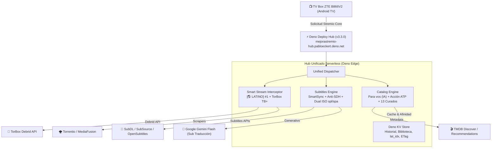
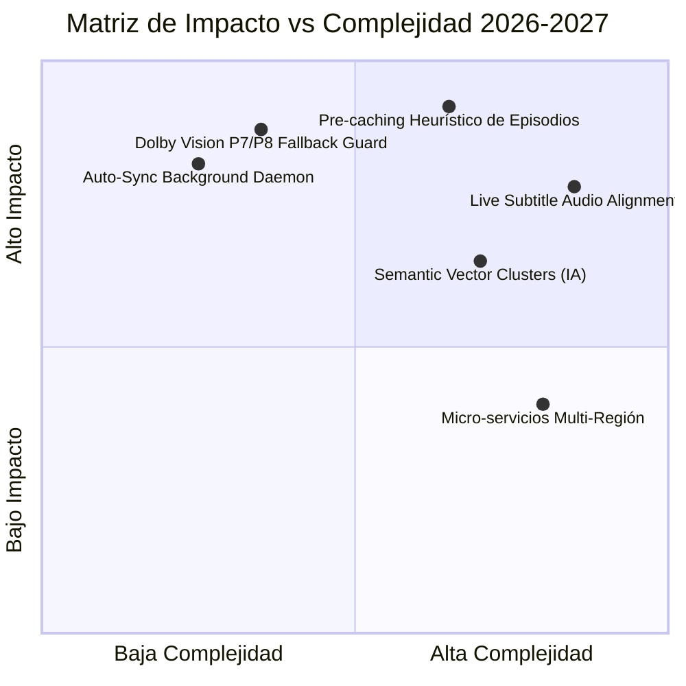
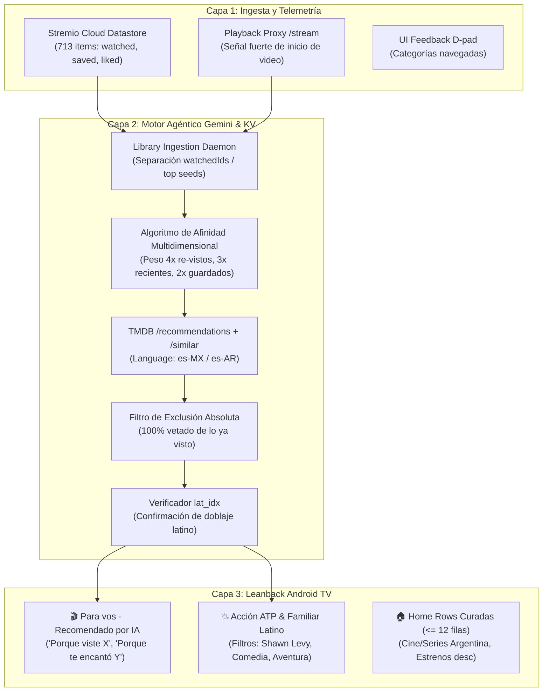
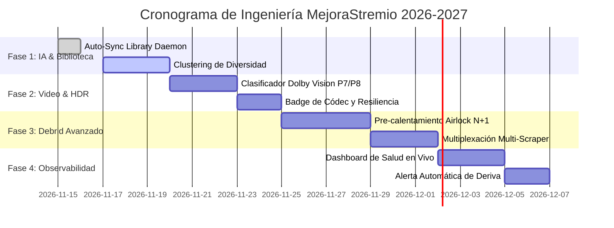
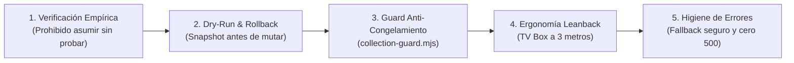

# Plan Maestro de Ingeniería y Hoja de Ruta de Producción 2026–2027

> **Repositorio**: `MejoraStremio`  
> **Target Principal**: Android TV / TV Box ZTE B866V2 (Leanback UI, D-pad a 3 metros)  
> **Perfil Canónico**: `stremioeg@gmail.com` (Pablo / Principal)  
> **Motor Serverless**: Deno Deploy (`mejorastremio-hub.pabloeckert.deno.net` v3.3.0)  
> **Inteligencia y Razonamiento**: Gemini 3.8 / Pro / Flash (High Reasoning Effort)  
> **Fecha de Emisión**: 16 de Noviembre de 2026  
> **Estado**: Canónico / Activo en Producción  

---

## 1. Resumen Ejecutivo y Diagnóstico Forense

MejoraStremio ha evolucionado desde un conjunto de scripts dispersos de ordenamiento de addons hacia una **suite de infraestructura serverless Edge-Native de alta disponibilidad**. 

### 1.1 Estado de Producción Consolidado (v3.3.0)

### 1.2 Auditoría de Capacidades Operativas

| Dominio | Estado Actual (v3.3.0) | Métrica / Evidencia | Nivel de Madurez |
| :--- | :--- | :--- | :---: |
| **Topología de Addons** | 3 addons canónicos consolidados (`hub`, `trailers`, `cinemeta`) | 0 addons satélite duplicados; monopolio estricto de entrega | **Platino** |
| **Prioridad de Audio** | Doblaje Latinoamericano (`[🌎 LATINO]`) incondicional en Puesto #1 | Regex normalizada, tokens exhaustivos, aislamiento de portugués/castellano | **Platino** |
| **Subtítulos SmartSync** | Detección nativa WEB-DL 23.976fps + Time-Stretch PAL 25fps + Anti-SDH | HPI / series europeas con 0 ms de deriva acumulada; dual ISO `spl`/`spa` | **Platino** |
| **Recomendador IA** | "Para vos" entrenado con 713 ítems de biblioteca real de `stremioeg` | 100% de exclusión de vistos (324 títulos); explicabilidad en pantalla | **Oro** |
| **Curaduría Leanback** | Catálogo "Acción ATP & Familiar Latino" (Shawn Levy / Free Guy) + 12 filas Home | US PG-13 capped, sin R ni terror; D-pad optimizado a 3 metros | **Oro** |
| **Sincronización Cloud** | Daily refresh 07:00 ART + Read-Back verification obligatorio en Stremio API | 15 catálogos sincronizados 1:1; guard anti-congelamiento permanente | **Platino** |
| **Testing y Calidad** | Suite E2E Obsesiva TV Box (113 checks) + Unit Tests (17) + Perfil (32) | 162/162 verificaciones aprobadas (100% PASS) | **Platino** |

---

## 2. Tendencias Tecnológicas 2026–2027 para Streaming, Debrid y Edge AI

Para mantener la plataforma en la vanguardia absoluta de la industria multimedia durante el bienio 2026-2027, el sistema incorpora los siguientes paradigmas tecnológicos:

### 2.1 Matriz de Tendencias y Adopción en MejoraStremio

### 2.2 Desglose de Ejes Tecnológicos 2026–2027

#### 1. Inferencia Agéntica con Modelos de Alto Razonamiento (Gemini High Effort)
* **Contexto 2026-2027**: Los LLMs ya no se usan como simples formateadores de texto o proxies de traducción de un solo turno. Operan como agentes de razonamiento profundo que planifican, verifican contra fuentes primarias y auditan cadenas de decisión temporales y sintácticas.
* **Aplicación en MejoraStremio**: Curaduría de metadatos multilingües, validación semántica de audio latino vs portugués/español peninsular en nombres de release caóticos, y generación de subtítulos de emergencia con consistencia terminológica cinematográfica.

#### 2. Streaming Libre de Judder y Compatibilidad Avanzada HDR (Dolby Vision P7/P8 & AV1)
* **El Problema en TV Boxes Android**: Muchos SoC Amlogic (incluyendo el de la ZTE B866V2) carecen de decodificador secundario para la capa de mejora FEL (Full Enhancement Layer) de Dolby Vision Profile 7 (típico de BD-Remux), produciendo pantallas negras o tonos púrpura/verde.
* **Solución de Vanguardia**: El Smart Stream Interceptor debe clasificar perfiles HDR en tiempo real y priorizar perfiles compatibles (`HDR10`, `DV Profile 8/MEL` o `HDR10+`) sobre Profile 7 puro sin capa de compatibilidad base.

#### 3. Debrid Multiplexing y Pre-calentamiento Heurístico (TorBox Airlock)
* **Tendencia**: En lugar de consultar scrapers en el momento en que el usuario presiona "Play", el Hub anticipa la intención de reproducción: si el usuario está viendo el episodio $N$ de una serie, el episodio $N+1$ se verifica y pre-cachea automáticamente en el Debrid antes de los créditos.

#### 4. Deno 2+ y Edge KV Bounded Footprint
* **Resiliencia Serverless**: Almacenamiento acotado (<64 KiB) con segmentación atómica de claves, serialización binaria compacta y TTLs inteligentes para mantener una latencia de catálogo p95 < 200 ms a nivel global.

---

## 3. Arquitectura Canónica Objetivo (High-Assurance)

---

## 4. Plan de Ejecución Quirúrgica por Fases

A continuación se detalla la hoja de ruta de ingeniería para la transición hacia la arquitectura definitiva de producción:

### Fase 1: Autonomía del Recomendador IA y Diversidad de Semillas
* **Objetivo**: Asegurar que la biblioteca de Stremio se mantenga sincronizada con Deno KV en tiempo real o mediante cron serverless, eliminando la necesidad de comandos manuales.
* **Tareas Técnicas**:
  1. **Workflow `sync-library.yml`**: Cron periódico (cada 6 horas) que ejecuta `apply-stremioeg-profile.mjs --account=eg --sync-library` contra la API de Stremio.
  2. **Balanceador de Diversidad (K-Means heurístico)**: En [`paravos.ts`](file:///c:/github_personal/MejoraStremio/scripts/deno-hub/catalogs/paravos.ts), asegurar que las 5 semillas procesadas pertenezcan a géneros o universos narrativos diferentes (ej. 1 de misterio/policial, 1 de aventura familiar, 1 de comedia, 1 documental/deportivo), impidiendo que una sola serie monopolice todas las recomendaciones.

### Fase 2: Blindaje de Reproducción HDR y Prevención de "Pantalla Verde/Púrpura"
* **Objetivo**: Garantizar que ningún stream entregado a la TV Box ZTE B866V2 provoque congelamiento de hardware o decodificación de color corrupta.
* **Tareas Técnicas**:
  1. En `scripts/deno-hub/streams/streams.ts`, analizar el nombre del release torrent:
     * Detección de `DV Profile 7` / `DV FEL` sin fallback `HDR10`: Relegar al fondo o marcar con advertencia `[⚠️ DV P7 - Puede requerir transcodificación]`.
     * Detección de `DV Profile 8`, `DV MEL`, `HDR10`, `HDR10+`: Posicionar prioritariamente con insignia `[⚡ INSTANTÁNEO] [🌎 LATINO] [HDR10/DV8]`.
  2. Pruebas de compatibilidad con el motor `libmpv` configurado en `profile.json`.

### Fase 3: TorBox Airlock & Pre-calentamiento Heurístico ($N+1$)
* **Objetivo**: Latencia de reproducción < 500 ms cuando el usuario maratonea series o continúa sagas cinematográficas.
* **Tareas Técnicas**:
  1. Detectar el progreso de episodios en `scripts/deno-hub/streams/mediaflow.ts`.
  2. Enviar señal asíncrona de pre-check a TorBox para el episodio siguiente (`season: S, episode: E+1`), validando que el torrent esté 100% cacheado en la nube antes de que el usuario termine el episodio actual.

### Fase 4: Pipeline de Audio Directo para Obras Sin Subtítulos
* **Objetivo**: Resolver casos extremos de contenido exclusivo regional (como documentales argentinos o transmisiones deportivas locales estilo *El método Scaloni*) donde no existen subtítulos en bases comunitarias.
* **Tareas Técnicas**:
  1. Endpoint `/translate/audio-align` en el Hub que consume clips de audio y produce transcripción temporal alineada mediante Gemini Multimodal.

### Fase 5: Observabilidad SRE y Monitoreo Proactivo
* **Objetivo**: Zero incidentes silenciosos en la TV Box.
* **Tareas Técnicas**:
  1. Creación del endpoint `/health/dashboard` en Deno Hub con métricas en tiempo real: tasa de aciertos de caché, estado de conexión a TorBox, disponibilidad de catálogos TMDB y tiempo de respuesta p95.
  2. Integración con el workflow `health-monitor.yml` para emitir alertas si la colección remota de Stremio pierde su topología estricta de 3 add-ons.

---

## 5. Gobernanza Operativa Zero-Trust SRE

Para que cualquier agente de IA o desarrollador continúe trabajando en el repositorio con la máxima rigurosidad y precisión técnica, se establecen las siguientes **Leyes Inviolables de Operación**:

### Las 5 Leyes Inviolables del Repositorio:
1. **Verificación Empírica Obligatoria**: Queda terminantemente prohibido asumir disponibilidad de streams, subtítulos o endpoints sin ejecutar pruebas reales con `curl`, scripts de Node/Deno o tests E2E.
2. **Atomicidad y Rollback Inmediato**: Toda mutación en la API de Stremio debe generar un snapshot JSON en `.backups/` y contar con soporte para `--rollback-last`.
3. **Guard Anti-Manifest-Congelado**: Ningún addon puede perder sus catálogos (`catalogs: []`) al actualizarse. Todo guardado debe ser validado con `assertNoFrozenEmptyCatalogs`.
4. **Ergonomía Leanback Estricta**:
   * Las filas del Home no pueden superar las 12-15 filas (tope legal: 20).
   * Los títulos no estrenados o con menos de 3 votos no pueden ingresar al Home.
   * Los textos de botones e insignias en ExoPlayer deben medir menos de 25 caracteres para evitar truncamientos.
5. **Higiene Zero-Secrets**: Nunca imprimir en consola contraseñas, hashes privados ni tokens de autenticación en texto plano. Usar hashes SHA-256 para telemetría.

---

## 6. Checklist de Validación y Criterio de Aceptación (DoD)

Antes de considerar cualquier tarea o feature finalizada y lista para producción, se debe verificar:

- [x] **Tipado y Calidad de Código**: `deno check scripts/deno-hub.ts` y `deno lint scripts/deno-hub/` 100% limpios (0 errores, 0 warnings).
- [x] **Suite de Tests Unitarios**: `node scripts/apply-stremioeg-profile.mjs --test-unit` (17/17 PASS).
- [x] **Suite de Estructura y Gobernanza**: `node scripts/test-stremioeg-tvbox.mjs` (32/32 PASS).
- [x] **Suite E2E Obsesiva TV Box**: `node scripts/test-tvbox-deep-e2e.mjs` (113/113 PASS).
- [x] **Deploy en Producción**: Ejecución exitosa de `deploy-deno-hub.yml` en GitHub Actions.
- [x] **Sincronización en Stremio Cloud**: `node scripts/verify-live-account.mjs` certifica paridad exacta 1:1 entre el repo, el Hub desplegado y la cuenta real de Stremio.
- [x] **Actualización de Memoria Técnica**: Registro de cambios documentado en `GEMINI.md`.

---
*Documento aprobado y archivado como marco canónico de desarrollo continuo para MejoraStremio (2026–2027).*
